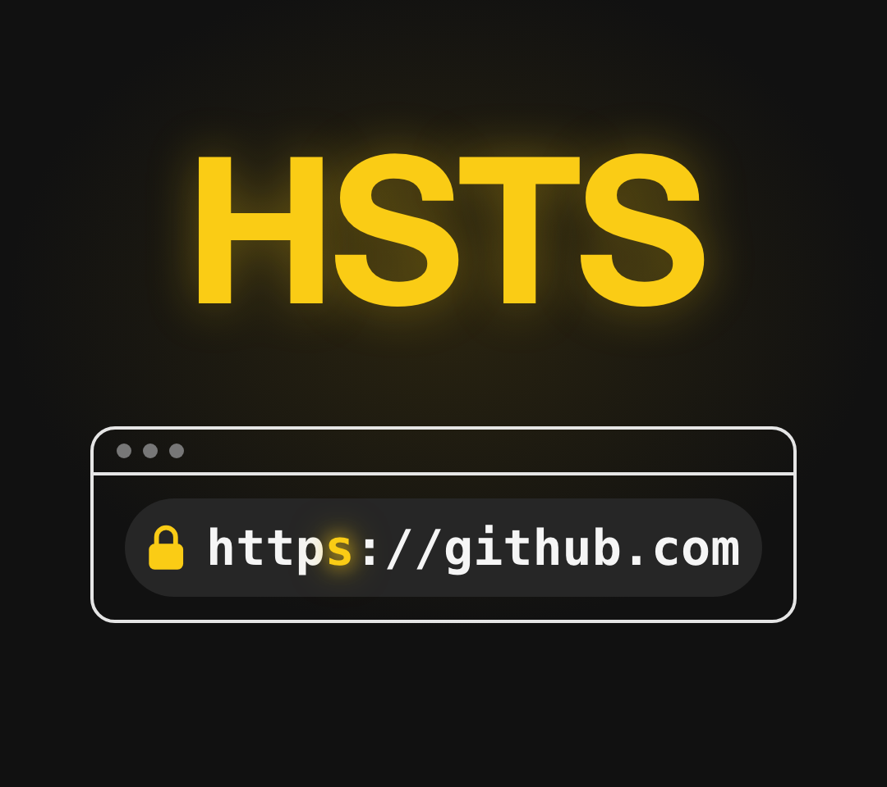
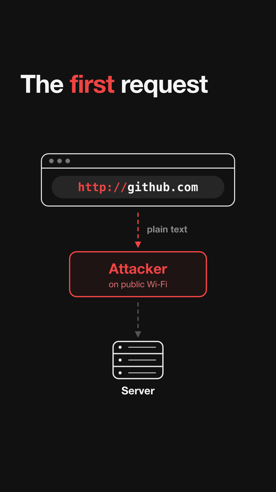
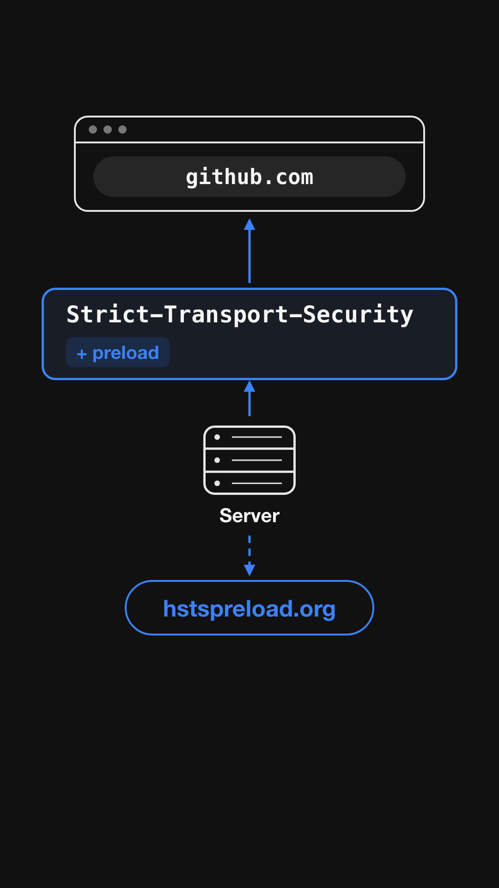
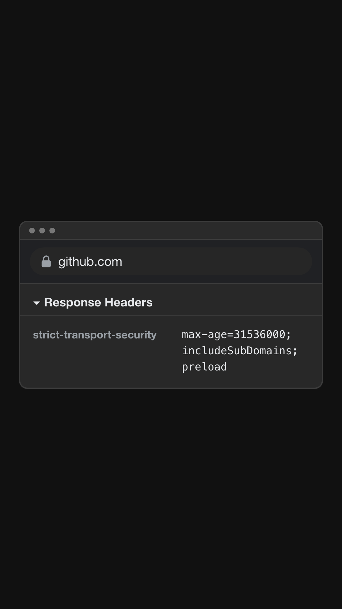
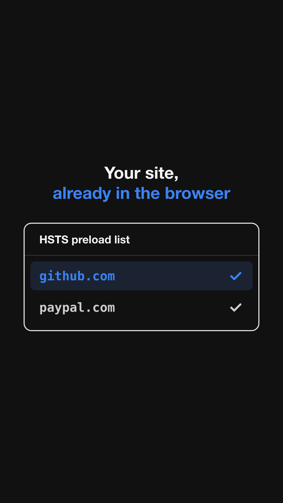
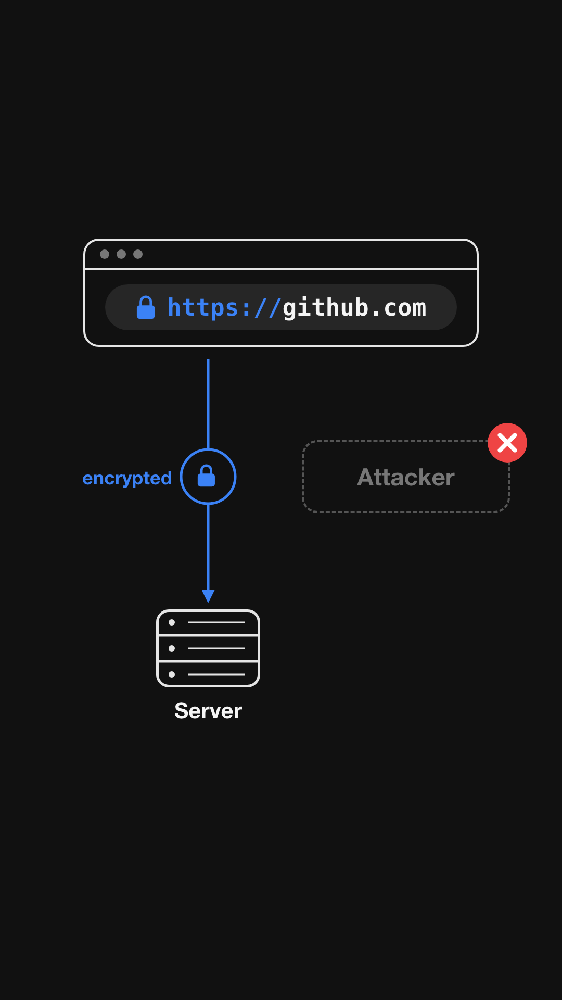

# HSTS: Why HTTPS Alone Is Not Enough



**TL;DR:** Your site has HTTPS, but the **first request** a browser sends can still be plain `http://`.
**HSTS** tells the browser: *"Always use HTTPS for this site. Never try `http://`."*

---

## 1. The problem: the first request



When you type `github.com`, the browser starts with **`http://github.com`**.

That first request travels in **plain text**. On public Wi-Fi (café, airport, hotel), an attacker can sit in the middle and:

- read what you send
- change the page you get back
- keep you on `http://` forever (this attack is called **SSL stripping**)

The server's redirect to `https://` comes **too late**. The attacker already has the request.

---

## 2. The fix: one response header



HSTS stands for **HTTP Strict Transport Security**. The server adds one header to its responses:

```
Strict-Transport-Security: max-age=31536000; includeSubDomains; preload
```

Two things happen:

1. **The browser remembers it.** From now on, it uses HTTPS only for this site.
2. **With `preload`,** the site owner can submit the domain to [hstspreload.org](https://hstspreload.org) to get it built into browsers (see step 4).

---

## 3. See it for yourself



GitHub really sends this header. Check it in 10 seconds:

**In the browser:**
1. Open [github.com](https://github.com)
2. Open DevTools (`F12`, or `Cmd + Option + I` on Mac)
3. Go to **Network** → reload → click the first request → **Response Headers**
4. Find `strict-transport-security`

**In the terminal:**

```bash
curl -sI https://github.com | grep -i strict-transport
```

Output:

```
strict-transport-security: max-age=31536000; includeSubDomains; preload
```

### What each part means

| Part | Meaning |
| --- | --- |
| `max-age=31536000` | Remember "HTTPS only" for this many seconds. `31536000` = **1 year**. |
| `includeSubDomains` | Apply the rule to every subdomain too (`api.github.com`, `docs.github.com`, ...). |
| `preload` | "I'm OK with being added to the browser's built-in HTTPS-only list." |

---

## 4. The preload list: safe even on the first visit



Without preload, the browser only learns the rule **after** its first visit. That first visit is still exposed.

So browsers (Chrome, Firefox, Safari, Edge) ship with a built-in **HSTS preload list**. Sites like `github.com` and `paypal.com` are on it.

If your site is on the list, the browser knows to use HTTPS **before you ever visit it**.

---

## 5. The result



Now when you type `github.com`, the browser goes **straight to `https://`**, before anything leaves your device.

- No plain `http://` request is ever sent, so the attacker has nothing to read or change.
- If someone shows a **fake certificate**, the browser blocks the page. There is no "continue anyway" button.

---

## Add HSTS to your own site

Only add this **after** your site (and every subdomain) works fully over HTTPS.

**Nginx**

```nginx
add_header Strict-Transport-Security "max-age=31536000; includeSubDomains; preload" always;
```

**Apache**

```apache
Header always set Strict-Transport-Security "max-age=31536000; includeSubDomains; preload"
```

**Express (Node.js)**

```js
app.use((req, res, next) => {
  res.setHeader("Strict-Transport-Security", "max-age=31536000; includeSubDomains; preload");
  next();
});
```

Then submit your domain at [hstspreload.org](https://hstspreload.org).

> **Careful:**
> - Start with a small `max-age` (like `300` = 5 minutes) to test, then raise it to 1 year.
> - `includeSubDomains` means **every** subdomain must support HTTPS, or it will stop loading.
> - Getting **off** the preload list takes months. Only add `preload` when you're sure.

---

## Recap

1. The first `http://` request travels in plain text, so it can be attacked.
2. The `Strict-Transport-Security` header makes the browser remember "HTTPS only".
3. You can see GitHub send it in DevTools or with `curl`.
4. The preload list protects even the very first visit.
5. Result: HTTPS every time, and the attacker is locked out.

---

*Made for my Instagram reel on HSTS. If this helped, share it with a friend!*
